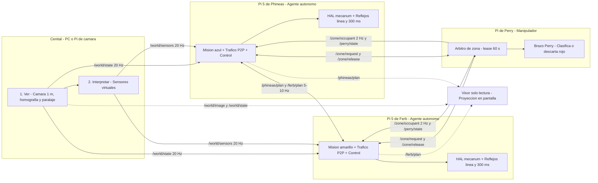
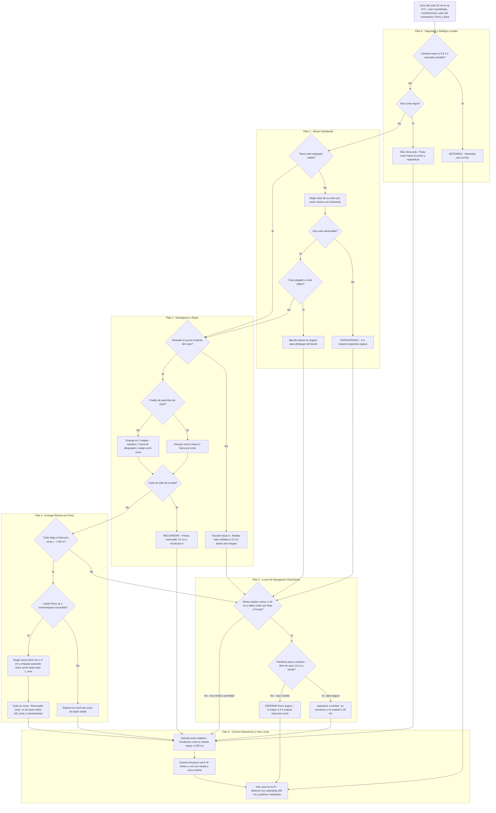
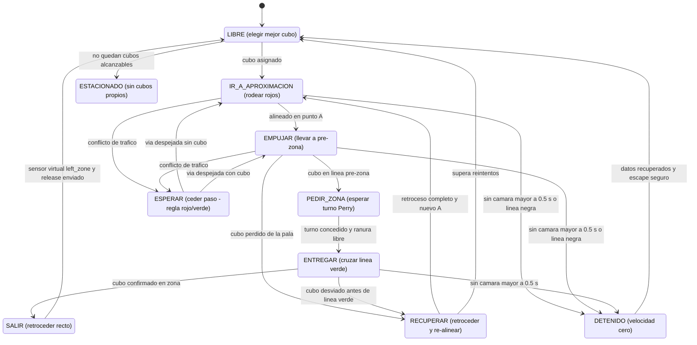
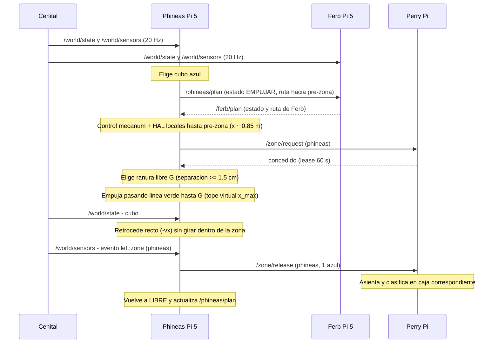
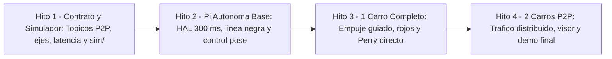

# Estrategia de Solución: Phineas y Ferb bajo Cámara Cenital (Pizarra)

> [!IMPORTANT]
> **Veredicto y corrección arquitectónica:** En los documentos revisados (`arquitectura.md`, `contrato.md`, `decisiones.md`, `pista.md`, `preguntas.md` y `plan-flota-tri-state.html`), la estrategia **estaba definida de forma parcial (~60 %)**, con **6 vacíos operativos** y **1 inconsistencia interna** (`PEDIR_ZONA`). Además, esos borradores asumían una **"Flota PC"** central que **no existe**: **cada carro (Phineas y Ferb) lleva su propia Raspberry Pi 5 encargada de toda su planificación, tráfico y control a bordo**. Este documento corrige esa arquitectura y cierra toda la estrategia en formato simple para pizarra.

---

## 1. Diagnóstico: ¿Qué había, qué cambió y qué faltaba?

| Lo que decían los borradores | Lo que FALTABA o se corrigió (definido aquí) |
| --- | --- |
| **Arquitectura asumida:** un cerebro central en "Flota PC" enviaba `/phineas/cmd` y `/ferb/cmd` por Wi-Fi a los carros y hablaba con Perry. | **Arquitectura real descentralizada:** cada carro corre el mismo código en su **propia Pi 5** (configurada con `phineas.yaml` o `ferb.yaml`). Cada Pi planifica su misión, coordina tráfico **punto a punto (`P2P`)** con el compañero, pide turno directo a Perry y ejecuta control + HAL localmente. El **visor** es solo lectura en pantalla. |
| **Roles y paradigma:** Cenital ve y calcula sensores virtuales; cada carro conserva reflejos locales de línea negra y vigilancia de 300 ms. | **Lazo interno sin salto de red:** al planificar en la propia Pi, control y motores comparten reloj y placa. La vigilancia de 300 ms protege si el nodo de control interno se cuelga, y la Pi frena a los 500 ms si deja de recibir la cámara. |
| **Reparto de colores:** Phineas toma azules, Ferb toma amarillos y los rojos se evitan. | **Selección de cubo y fin de color:** función de costo con histéresis (objetivo pegajoso), barrido en ángulo para cubos pegados a la cinta negra y estado `ESTACIONADO` al terminar su color. |
| **Rojos y tráfico:** círculos de 17 cm para no chocar y duda abierta sobre rojos (D7: 17 cm vs. 12 cm + pasillo). | **Cierre operativo de D7 y anti-bloqueo:** 12 cm en tránsito + pasillo libre al empujar (con quiebre `C -> M -> G` en 2 etapas) dejando 17 cm parametrizable para validar en `sim/`, más prioridad P2P idéntica en ambas Pi y `sidestep` lateral contra atascos. |
| **Esqueleto de estados y entrega:** FSM y secuencia se contradecían sobre cuándo pedir la zona a Perry. | **Coreografía directa con Perry (inconsistencia corregida):** cada Pi empuja hasta una **línea pre-zona**, pide `/zone/request` directo a Perry, elige ranura libre (≥ 1,5 cm), respeta un tope virtual sin cinta negra, retrocede recto y llama `/zone/release`. |
| **Interrupciones y retardo:** `ESPERAR`, `DETENIDO`, `RECUPERAR` nombrados y alerta por ping Wi-Fi. | **Protocolo de recuperación por falla:** pasos exactos al perder el cubo, perder el plan del compañero, perder la cámara o pisar la cinta negra (`stopped_line`). |

---

## 2. Pizarra 1 — Arquitectura Híbrida Descentralizada (sin Flota PC)

- **Cenital** *"ve, pero es mocha"*: mide el mundo (~20 Hz), corrige paralaje y publica `/world/state` y `/world/sensors` directo a ambos carros. No da órdenes.
- **Phineas (Pi 5) y Ferb (Pi 5)** *"cada carro piensa y se mueve solo"*: ambos corren el **mismo software** (solo cambian `phineas.yaml` y `ferb.yaml`). Cada Pi lee el mundo de Cenital, elige su cubo, coordina tráfico punto a punto (`peer-to-peer`), pide turno directo a Perry y ejecuta control mecanum + HAL + reflejos locales en la misma placa.
- **Manipulador (Pi de Perry):** mantiene el árbitro de zona (`lease` de 60 s) y clasifica cubos (o descarta si entra un rojo).
- **Visor (solo lectura):** ventana en pantalla (en la PC de Cenital o laptop de monitoreo) que solo dibuja `/world/image`, `/world/state`, `/phineas/plan` y `/ferb/plan` — **no decide ni envía comandos**.



> [!NOTE]
> **Ventaja clave sin PC central y regla de relojes:** planificador, controlador y motores viven en la **misma Pi** (cero latencia de red en el lazo interno y mismo reloj). Para los mensajes externos (`/world/state`, `/zone/occupant`, `/<compañero>/plan`), las Raspberry Pi no tienen pila de reloj, así que cada Pi mide la edad siempre con su **propio reloj local** desde que los recibe.

---

## 3. Pizarra 2 — Mapa de la Pista y Geometría Clave

```text
  y (hacia caja amarilla)
  ^
  |  +=================== CINTA NEGRA (116,5 x 70 cm) ==================+   +-----------+
  |  |  . . . . . . . . . margen virtual interior . . . . . . . . . . . |   |   CAJA    |
  |  |                                                |                 |   | AMARILLA  |
  |  |      (A) ----> [C] ~ ~ ~ (M)                   |  carril sup.    |   +-----------+
  |  |                         \   \                  |                 |
  |  |                punto     \   (R rojo 12 cm)    |  linea          |------ MUESCA AZUL
  |  |                rojo (c)   \                    |  pre-zona       | [ranura 1] |    x_max
  |  |                   o        +------------------>|  x ~ 0,85 m     |    >= 1,5 cm   (tope)  --> PERRY
  |  |                                                |                 | [ranura 2] |  (sin
  |  |   [Estacionamiento]                            |  carril inf.    |            |  cinta)
  |  |   si acaba color                               |                 |------ LINEA VERDE
  |  |                                                |                 |
  |  |  . . . . . . . . . . . . . . . . . . . . . . . . . . . . . . . . |   +-----------+
  |  +==================================================================+   |   CAJA    |
  (0, 0) -----------------------------------------------------------------> |   VERDE   |
                                                                          x +-----------+
```

### Números rápidos de pizarra

| Parámetro | Valor | Nota |
| --- | --- | --- |
| Pista interior | `116,5 × 70 cm` | Origen `(0, 0)` abajo-izquierda; `+x` hacia Perry |
| Chasis del carro | `18,6 × 16,1 × 9,1 cm` | Ruedas mecanum de 65 mm sin encoders |
| Tamaño del cubo | `2,5 cm` (~24 px) | Se corrige paralaje con `h = 0,0125 m` |
| Cámara cenital | `H = 1,00 m` (1280 × 720 px) | Paralaje techo (~9 cm): hasta `~6,7 cm` en esquinas (lo corrige Cenital) |
| Radio seguridad carro | `17 cm` | Distancia mínima entre centros de carros: `34 cm` |
| Radio rojo (tránsito) | `12 cm` | Medio ancho del carro + margen para rodear sin bloquear cubos |
| Vigilancias | `300 ms` (HAL) / `500 ms` (cámara) | `300 ms` en el HAL interno si se cuelga el control; `500 ms` si deja de llegar `/world/state` |

---

## 4. Pizarra 3 — La Estrategia Completa en 6 Pilares (Pi autónoma por carro)

### Pilar 1 — Misión Distribuida (sin conflictos de cubo)

- **Partición natural por color:** la Pi de **Phineas** solo evalúa cubos **azules**, la Pi de **Ferb** solo **amarillos**, y los **rojos** son obstáculos. Así nunca compiten por el mismo cubo aunque no exista un coordinador central.
- **Selección por costo mínimo** entre cubos alcanzables del color propio:

```text
Costo = d(carro, A) + d(C, G) + Pen_cruce + Pen_borde + Pen_rojo
```

  *(Cada Pi calcula `Pen_cruce` comparando su ruta con la ruta que el compañero publica en `/<compañero>/plan`.)*
- **Histéresis (objetivo pegajoso):** una vez elegido un cubo, la Pi lo mantiene hasta entregarlo o entrar en falla, evitando oscilar de objetivo en cada cuadro.
- **Cubos pegados a la cinta negra:** si el punto de aproximación `A` cae fuera del margen virtual interior, la Pi ejecuta un **barrido lateral en ángulo** para despegar el cubo del borde antes de empujarlo a la zona (o lo pospone para el final si es riesgoso).
- **Fin de color:** cuando no quedan cubos alcanzables de su color, el carro pasa a `ESTACIONADO` en una esquina izquierda libre (fuera del corredor hacia la zona) para dejar el paso despejado. *(Si el profesor autoriza ayuda cruzada, cada Pi excluye el `target_cube_id` anunciado en `/<compañero>/plan` y desempata simultáneos con `Phineas > Ferb`.)*

### Pilar 2 — Navegación y Cubos Rojos (Cierre operativo de D7)

- **Por qué no usar 17 cm fijos en todo momento:** en la captura real de la pista, un cubo azul vecino a un rojo queda a ~12 cm y sería inalcanzable con un radio fijo de 17 cm.
- **Estrategia base en 2 pasos en cada Pi** *(dejando 17 cm configurable por parámetro para comparar en `sim/`)*:
  1. **Tránsito sin cubo (`IR_A_APROXIMACION`, `SALIR`):** inflar cada cubo rojo a **12 cm** (medio carro + margen) y calcular puntos intermedios rodeando rojos, el círculo del compañero y el borde interior de la cinta negra.
  2. **Empuje con cubo (`EMPUJAR`):** alinear al carro en el punto de aproximación detrás del cubo `C` hacia el destino `G`:
     `A = C + d · (C - G) / |C - G|`
     y verificar el **pasillo de la pala** (banda de ~18 cm de ancho entre `A` y `G`):
     - **Pasillo libre:** empujar directo en línea recta.
     - **Rojo en el pasillo:** ejecutar **empuje en 2 etapas (quiebre)**: empujar `C` primero a un punto intermedio despejado `M`, re-alinear detrás de `M` y empujar `M -> G`. Si no existe `M` libre, posponer el cubo.
- **Respaldo:** si un cubo rojo entra por accidente a la zona, Perry lo descarta fuera de las cajas.

### Pilar 3 — Anti-Colisión con Luces de Navegación (Rojo/Verde)

- **Alerta desde Cenital con las marcas físicas existentes:** los **triángulos físicos del techo (D3)** permiten a Cenital medir `(x, y, θ)` y alertar posibles colisiones en `/world/sensors` cuando la separación baja de **34 cm** (o proyectada a `0,5 s`), sin añadir stickers ni LEDs rojos/verdes físicos que contaminen la detección de cubos rojos o línea verde.
- **Regla de Luces de Navegación** (babor = **rojo** a la izquierda, estribor = **verde** a la derecha, según dirección de movimiento):
  1. *Excepción de maniobra restringida:* quien está en `SALIR`, `ENTREGAR` o `EMPUJAR` (con cubo) tiene prioridad sobre un carro libre sin cubo.
  2. *Misma condición:*
     - **Ves ROJO** (compañero entra por tu derecha) → **cedes el paso**.
     - **Ves VERDE** (compañero entra por tu izquierda) → **mantienes tu ruta**.
     - **De frente** → **ambos se apartan a estribor (`-vy` mecanum)**; si no cabe, frena `Ferb` como desempate fijo.
     - **Alcance (popa)** → el de atrás frena o rodea.
- **Planificar primero y luego moverse (protección de cubos rojos):** antes de apartarse a estribor, la Pi verifica en `< 0,1 ms` sobre `/world/state` que el paso proyectado (~15–20 cm) quede **dentro del margen virtual interior** y a **`≥ 12 cm` de todo cubo rojo** (sin arrastrar su cubo hacia un rojo). Si estribor está bloqueado, **no se mueve a ciegas**: frena (`ESPERAR`) y, si sigue bloqueado > 3 s, evalúa un retroceso recto seguro (`-vx`). El chequeo se repite a ~20 Hz mientras se mueve.
- **Simplicidad extra:** el sistema anti-colisión funciona incluso sin comunicación `/phineas/plan` ↔ `/ferb/plan` entre carros (solo depende de `/world/state` y `/world/sensors`).

### Pilar 4 — Coreografía de Entrega Directa con Perry

Corrige la contradicción entre los borradores separando el acercamiento por la pista del cruce hacia Perry; **cada Pi habla directo con Perry**:

1. **Acercar (`EMPUJAR`):** llevar el cubo hasta la **línea pre-zona** (`x ≈ 0,85 m`), usando carril superior o inferior si ambos carros coinciden.
2. **Pedir turno (`PEDIR_ZONA`):** la Pi verifica que `/zone/occupant` tenga latido reciente (< 2 s) y `/perry/state` sea distinto de `gate_closed`; luego llama directamente a `/zone/request(mi_nombre)`. Si se niega, aguarda en pre-zona sin estorbar la salida.
3. **Cruzar y dejar (`ENTREGAR`):** con turno concedido (`lease` de 60 s), la Pi elige una **ranura libre** `G` pasando la línea verde (separada ≥ 1,5 cm de cualquier cubo visto en `/world/state` dentro de la zona) y empuja hasta `G` respetando el **tope virtual `x_max`**, porque en la muesca no hay cinta negra para el sensor de línea.
4. **Retirada recta (`SALIR`):** retroceder en línea recta (`-vx`) **sin girar dentro de la zona** (evita barrer el cubo con la pala) hasta que Cenital publique el evento virtual `left:zone`.
5. **Liberar:** la Pi llama directamente a `/zone/release(mi_nombre, delivered=True, color)` (o `delivered=False` si el cubo no quedó dentro). Perry asienta y clasifica.

### Pilar 5 — Control Holonómico y Retardo Reducido

Cada Pi ejecuta localmente el lazo de control mecanum hacia su pose objetivo:

$$e = p_{\text{objetivo}} - p_{\text{robot}}$$

$$[v_x, v_y]^T = \text{sat}\big(K \cdot R(-\theta) \cdot e\big), \qquad \omega_z = \text{sat}\big(K_\theta \cdot (\theta_{\text{objetivo}} - \theta)\big)$$

- **Ventaja y plan frente al retardo Wi-Fi** (en la etapa 1 hubo 560–870 ms de ping y Phineas ya oscilaba con 0,15 s):
  1. **Un salto menos de red:** al quitar el intermediario, solo existe el tramo `Cenital -> Pi` (`Control -> Motores` es local en la Pi).
  2. Usar un **enrutador dedicado** para los tres grupos (meta < 30 ms).
  3. Mantener **topes de velocidad conservadores**, rampa suave y zona muerta al llegar (`< 2 cm`, `< 5°`).
  4. Si la latencia `Cenital -> Pi` supera los 150 ms: aplicar predicción corta de pose (`p_pred = p_vista + v_cmd · retardo`) o avanzar por tramos cortos con pausa de confirmación.

### Pilar 6 — Recuperación ante Fallas e Interrupciones (en cada Pi)

| Situación / Estado | Cómo se detecta en la Pi | Acción exacta |
| --- | --- | --- |
| **`RECUPERAR`** (cubo se salió de la pala) | El cubo se desvía delante de la pala o sale de su ancho útil durante `EMPUJAR` o `ENTREGAR` | Frenar, retroceder ~12 cm en línea recta, recalcular `A` y volver a `IR_A_APROXIMACION` (máx. 2 reintentos antes de cambiar de cubo). |
| **`DETENIDO`** (cámara caída o marcador perdido) | Edad de `/world/state` > 0,5 s (reloj local de la Pi) o confianza baja del triángulo | Mandar `(0, 0, 0)` al HAL de inmediato; reanudar al recibir lecturas válidas. |
| **Reflejo `stopped_line`** (carro pisó cinta negra) | El HAL corta el avance solo y avisa `line_detected = true` al planificador en la misma Pi | La Pi ordena un pulso breve hacia el centro de la pista hasta `line_detected = false` y replanifica la ruta. |
| **Reflejo `stopped_watchdog`** (lazo interno colgado) | El HAL de la Pi pasa > 300 ms sin nueva orden local del nodo planificador | El HAL corta motores de forma autónoma y reanuda cuando llegan órdenes locales frescas. |
| **Zona bloqueada** (Perry ocupado o sin latido) | > 2 s sin `/zone/occupant` o `gate_closed` en `/perry/state` | Ningún carro cruza la línea pre-zona hasta restablecerse el latido y concederse el turno. |
| **Pérdida del plan del compañero** | Edad de `/<compañero>/plan` > 0,5 s (reloj local de la Pi) | El anti-colisión sigue operando normal con la alerta de Cenital y la regla rojo/verde; solo se degrada la penalización por cruce en la selección de cubo. |

---

## 5. Pizarra 4 — Diagrama de Movimiento del Robot (Los 6 Pilares en Acción)


### Flujo de decisión ciclo a ciclo (~20 Hz)

En cada ciclo (~20 Hz), la Pi 5 de cada carro recorre los 6 pilares en orden para convertir la vista cenital en movimiento holonómico seguro:



---

## 6. Pizarra 5 — Máquina de Estados Unificada (corre una instancia en cada Pi)

La Pi 5 de Phineas y la Pi 5 de Ferb ejecutan de forma independiente esta misma máquina de estados:



---

## 7. Pizarra 6 — Secuencia de una Entrega Completa (sin Flota PC)



---

## 8. Pizarra 7 — Hoja de Ruta Rápida y Ajustes Urgentes al Contrato



### 3 ajustes necesarios a `contrato.md` / `arquitectura.md` (por eliminar Flota PC)

1. **Tópicos de comando y plan:** `/phineas/cmd` y `/ferb/cmd` pasan a ser internos dentro de cada Pi, y `/fleet/plan` central se reemplaza por **`/phineas/plan` y `/ferb/plan`** (5–10 Hz, publicados por cada Pi para tráfico P2P y visor).
2. **Llamadas directas a Perry:** confirmar que **cada Pi llama directamente** a `/zone/request` y `/zone/release` con su propio nombre (sin intermediario).
3. **Suscripción doble a Cenital:** confirmar que **ambas Pi se suscriben en paralelo** a `/world/state` y `/world/sensors` de Cenital (QoS `best effort`, `keep last 1`).

### 4 acuerdos inmediatos para destrabar al equipo

1. **Firmar el contrato actualizado y `pista.md`:** cerrar los 3 ajustes anteriores, origen/ejes en metros/radianes y levantar `sim/` para probar sin cámara real.
2. **Definir los triángulos:** elegir dos colores distintos (que no choquen con cubos azules, amarillos, rojos ni línea verde) y tamaño isósceles alargado (~10 cm).
3. **Medir latencia y validar rojos en `sim/`:** probar con enrutador propio y comparar en simulación la regla de 12 cm + pasillo libre contra el radio de 17 cm.
4. **Confirmar detalles con Manipulador:** verificar la profundidad exacta tras la línea verde (`12–19,5 cm` desde el eje de Perry) y la separación mínima de `1,5 cm` entre cubos.
